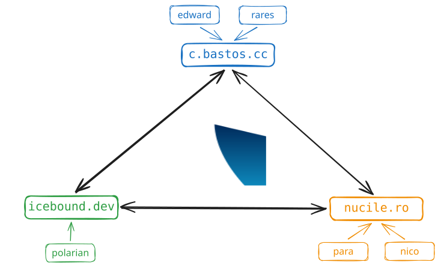
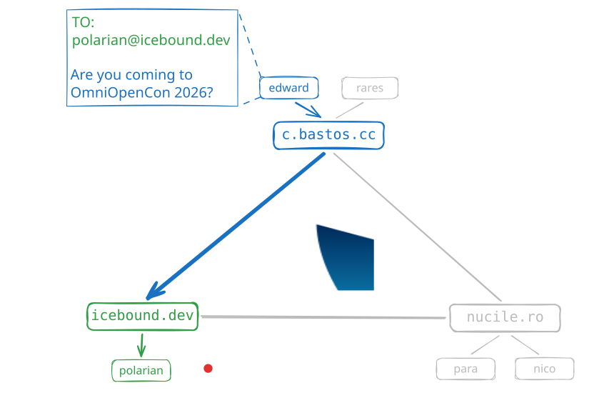

# OmniOpenCon 2026 Materials

This directory contains all the materials created by the volunteers for the
XMPP Stand at OmniOpenCon 2026.

For credits `git-blame` the corresponding files.

## Licencing

Licences can be found under `/licences`.

For `font/` see the included `font/README.txt` for licence information.

### [Creative Commons Attribution](./licences/CC-BY)

* `doc/*.svg`

### [Public Domain](./licences/PD)

* `doc/` excluding `doc/*.svg`
* `Makefile`

### [0 Clause BSD](./licences/0BSD)

Everything else not listed above within this directory

## Contents

### XMPP Protocol Diagrams

These diagrams were designed to explain the XMPP protocol at a high level.
There is two diagrams:

Located at: `doc/protocol-diagram.svg`

Located at: `doc/protocol-diagram-federation.svg`

These were created in [ExcaliDraw](https://excalidraw.com/) and can be
reuploaded and modified to your requirements. As these were designed
specifically for OmniOpenCon, it is recommended you do change out the
message content in the federation diagram, and potentially swap out the XMPP
operators used within the example to some which are more preferable to you.

### XMPP Graph

Static XMPP graph representation from the [XMPP Network
Graph](https://xmppnetwork.goodbytes.im/). This is useful at conferences
where rendering the network graph live can be difficult with bandwidth and
computational limitations.

It also is a piece of art, in the eyes of many of the stand volunteers at
OmniOpenCon :)

#### Dependencies

* `graphviz`
* `jq`

#### Building

`make graph/net.png`

You can then find the png at: `graph/net.png`.

### Leaflets

XMPP introduction leaflets were written for the stand after some volunteers
disliked the quality of the existing options. These are not conference
specific and can be used by anyone, for any purpose.

The main concern with previous leaflets was the inability to easily
translate them. These leaflets are written in troff, and is in plaintext,
anyone can easily translate the text into a different language if required.

Current languages are English (EN) and Romanian (RO).

#### Dependencies

* `ghostscript`
* `heirloom troff`

#### Building

For English leaflets:

`make doc/en.pdf`

You can then find the pdf at: `doc/en.pdf`.

For Romanian leaflets:

`make doc/ro.pdf`

You can then find the pdf at: `doc/ro.pdf`.

